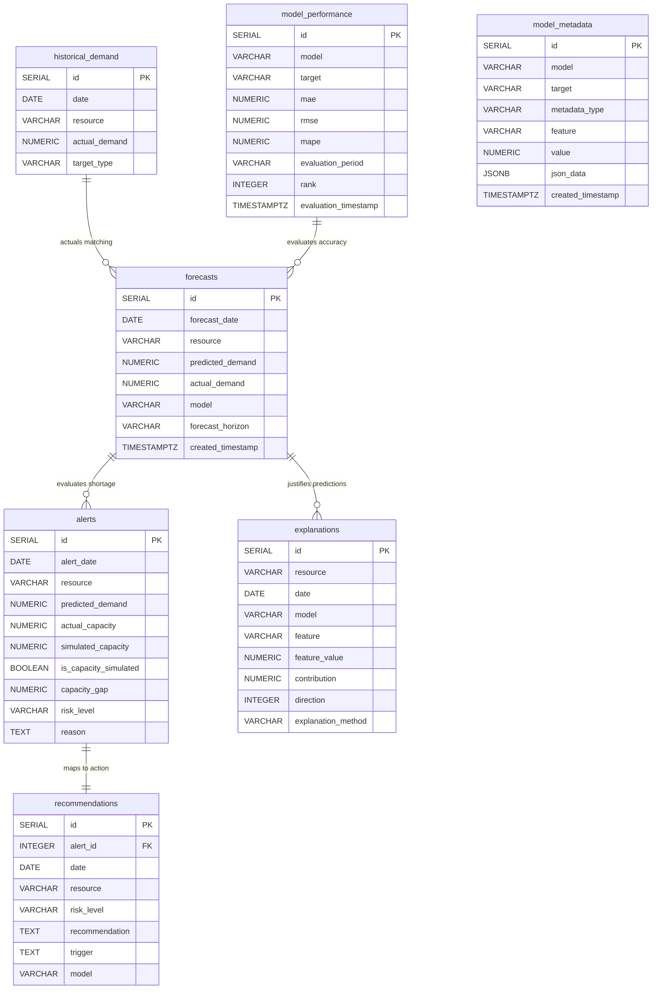

# Database Design Document

This document outlines the PostgreSQL database architecture, table definitions, relationships, indexes, and constraints for the Hospital Resource Intelligence platform.

---

## 1. Architectural Overview

The backend uses a normalized relational PostgreSQL schema to persist cleaning output files, model evaluation summaries, forecasts, risk alerts, decision engine recommendations, and model explanation vectors (SHAP/LIME).

---

## 2. Table Definitions

### A. `historical_demand`
Stores verified daily historical resource demand metrics (NHS beds, ICU beds occupied, ED daily arrivals).
* **Columns:**
  - `id` (SERIAL PRIMARY KEY)
  - `date` (DATE NOT NULL): Date of record.
  - `resource` (VARCHAR(50) NOT NULL): Name of the resource tracked (e.g., `'ICU Beds'`, `'ED Arrivals'`).
  - `actual_demand` (NUMERIC(12, 4) NOT NULL): Measured value.
  - `target_type` (VARCHAR(50) NOT NULL): Metric class (e.g., `'occupancy'`, `'arrivals'`).
* **Constraints:**
  - `UNIQUE (date, resource)` to prevent redundant daily entry.

### B. `forecasts`
Stores predictions generated by modeling pipelines for future dates.
* **Columns:**
  - `id` (SERIAL PRIMARY KEY)
  - `forecast_date` (DATE NOT NULL): The future date being forecast.
  - `resource` (VARCHAR(50) NOT NULL): Name of target resource.
  - `predicted_demand` (NUMERIC(12, 4) NOT NULL): Forecast value.
  - `actual_demand` (NUMERIC(12, 4) NULL): Populated retroactively once actuals are known.
  - `model` (VARCHAR(50) NOT NULL): Model name (e.g., `'Prophet'`, `'XGBoost'`, `'LSTM'`).
  - `forecast_horizon` (VARCHAR(20) NOT NULL): Look-ahead duration (e.g., `'7 days'`).
  - `created_timestamp` (TIMESTAMP WITH TIME ZONE DEFAULT CURRENT_TIMESTAMP NOT NULL): Forecast execution time.
* **Constraints:**
  - `UNIQUE (forecast_date, resource, model)` prevents multiple runs over writing predictions.

### C. `model_performance`
Stores aggregated validation scores comparing the performance of trained models.
* **Columns:**
  - `id` (SERIAL PRIMARY KEY)
  - `model` (VARCHAR(50) NOT NULL): `'Prophet'`, `'XGBoost'`, or `'LSTM'`.
  - `target` (VARCHAR(50) NOT NULL): `'icu_occupancy'` or `'ed_arrivals'`.
  - `mae` (NUMERIC(12, 6) NOT NULL): Mean Absolute Error.
  - `rmse` (NUMERIC(12, 6) NOT NULL): Root Mean Squared Error.
  - `mape` (NUMERIC(12, 6) NULL): Mean Absolute Percentage Error.
  - `evaluation_period` (VARCHAR(100) NOT NULL): Epoch interval boundaries.
  - `rank` (INTEGER NOT NULL): Model efficiency ranking based on MAE metric.
  - `evaluation_timestamp` (TIMESTAMP WITH TIME ZONE DEFAULT CURRENT_TIMESTAMP NOT NULL): Execution date.
* **Constraints:**
  - `UNIQUE (model, target)`

### D. `alerts`
Stores shortages computed when forecast limits exceed capacities.
* **Columns:**
  - `id` (SERIAL PRIMARY KEY)
  - `alert_date` (DATE NOT NULL)
  - `resource` (VARCHAR(50) NOT NULL)
  - `predicted_demand` (NUMERIC(12, 4) NOT NULL)
  - `actual_capacity` (NUMERIC(12, 4) NULL): Physical capacity limits. Always NULL for source datasets since no capacities were recorded.
  - `simulated_capacity` (NUMERIC(12, 4) NOT NULL): Simulated/administrative capacity used for simulation.
  - `is_capacity_simulated` (BOOLEAN DEFAULT TRUE NOT NULL): Mandatory indicator representing simulated boundaries.
  - `capacity_gap` (NUMERIC(12, 4) NOT NULL): Difference between capacity limit and prediction.
  - `risk_level` (VARCHAR(10) NOT NULL): Threat assessment indicator.
  - `reason` (TEXT NOT NULL)
* **Constraints:**
  - `UNIQUE (alert_date, resource)`
  - `CHECK (risk_level IN ('LOW', 'MEDIUM', 'HIGH'))`

### E. `recommendations`
Stores operational workflows triggered by resource-management logic.
* **Columns:**
  - `id` (SERIAL PRIMARY KEY)
  - `alert_id` (INTEGER REFERENCES alerts(id) ON DELETE CASCADE): Ties recommendations directly to alerts.
  - `date` (DATE NOT NULL)
  - `resource` (VARCHAR(50) NOT NULL)
  - `risk_level` (VARCHAR(10) NOT NULL)
  - `recommendation` (TEXT NOT NULL): Recommended administrative response.
  - `trigger` (TEXT NOT NULL): Decision trigger description.
  - `model` (VARCHAR(50) NOT NULL)
* **Constraints:**
  - `UNIQUE (date, resource)`
  - `CHECK (risk_level IN ('LOW', 'MEDIUM', 'HIGH'))`

### F. `explanations`
Stores explainability metadata (local feature contributions from SHAP or LIME).
* **Columns:**
  - `id` (SERIAL PRIMARY KEY)
  - `resource` (VARCHAR(50) NOT NULL)
  - `date` (DATE NOT NULL)
  - `model` (VARCHAR(50) NOT NULL)
  - `feature` (VARCHAR(100) NOT NULL): Explaining input feature.
  - `feature_value` (NUMERIC(12, 4) NOT NULL): Underlying measurement value.
  - `contribution` (NUMERIC(12, 6) NOT NULL): Model output scale influence.
  - `direction` (INTEGER NOT NULL): Explains positive (`1`) vs negative (`-1`) effect.
  - `explanation_method` (VARCHAR(10) NOT NULL): `'SHAP'` or `'LIME'`.
* **Constraints:**
  - `UNIQUE (resource, date, model, feature, explanation_method)`
  - `CHECK (direction IN (-1, 1))`
  - `CHECK (explanation_method IN ('SHAP', 'LIME'))`

### G. `model_metadata`
Stores general metadata, loss logs, and feature importances.
* **Columns:**
  - `id` (SERIAL PRIMARY KEY)
  - `model` (VARCHAR(50) NOT NULL)
  - `target` (VARCHAR(50) NOT NULL)
  - `metadata_type` (VARCHAR(50) NOT NULL): `'global_importance'`, `'loss_history'`, etc.
  - `feature` (VARCHAR(100) NULL)
  - `value` (NUMERIC(12, 6) NULL)
  - `json_data` (JSONB NULL)
  - `created_timestamp` (TIMESTAMP WITH TIME ZONE DEFAULT CURRENT_TIMESTAMP NOT NULL)
* **Constraints:**
  - `UNIQUE (model, target, metadata_type, feature)`

---

## 3. Indexing Strategy

To guarantee highly optimized response times for future API requests, indexes are built over filtering and join keys:

1. **`idx_historical_date_res`** on `historical_demand(date, resource)`
2. **`idx_forecast_date_res`** on `forecasts(forecast_date, resource)`
3. **`idx_alerts_date_res`** on `alerts(alert_date, resource)`
4. **`idx_explanations_lookup`** on `explanations(resource, date, model)`
5. **`idx_metadata_lookup`** on `model_metadata(model, target)`

---

## 4. Simulated-Capacity Limitation Warning

> [!WARNING]
> **Data Integrity Boundary:**
> The `alerts` table contains `actual_capacity` and `simulated_capacity` fields. Because the raw data does not include actual bed counts or ED capacities, `actual_capacity` is set to `NULL` for all alert logs, and `is_capacity_simulated` is set to `TRUE`. 
> 
> Under no circumstances must simulated thresholds (defined in `thresholds.py` and saved to `simulated_capacity`) be reported as real, physical constraints of the clinical facility. Doing so constitutes data fabrication.
