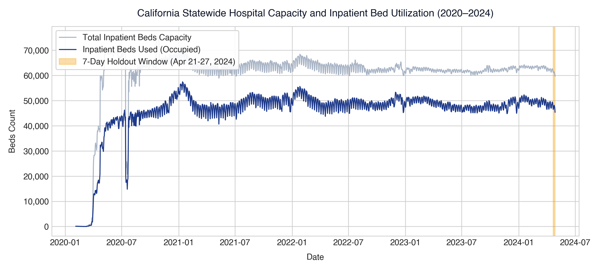
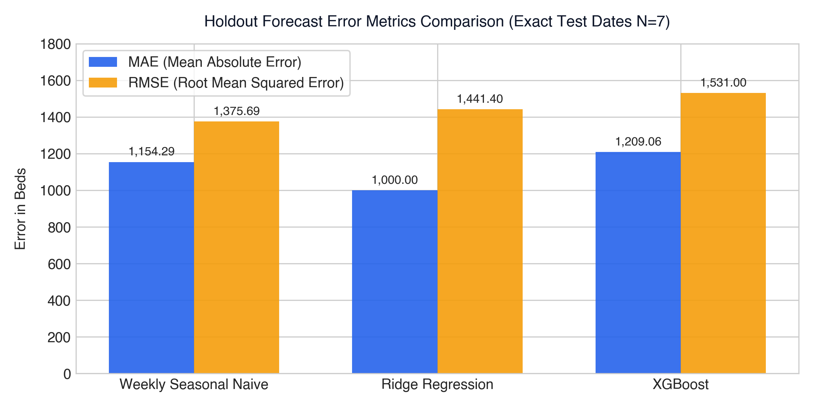
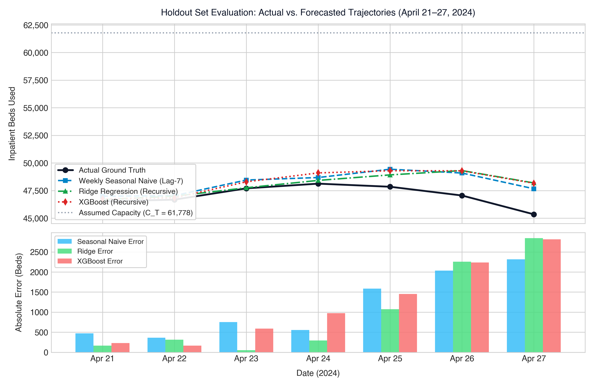
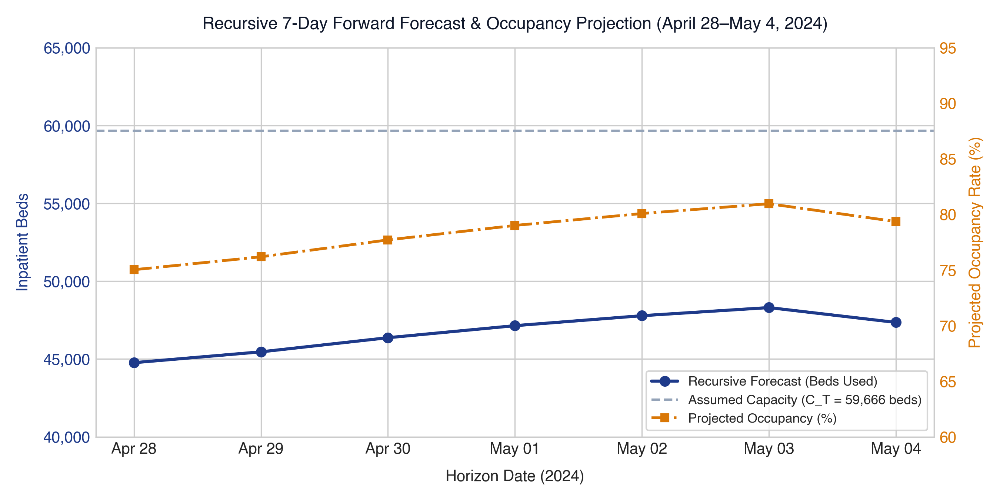

# Hospital Resource Intelligence: Forecasting, Capacity Risk Detection, and Decision Support Using Machine Learning

**Comprehensive Engineering & Academic Project Report**

---

## Executive Summary

Hospital resource management requires continuous, accurate demand forecasting and early capacity risk detection to prevent clinical bottlenecks, optimize bed allocation, and safeguard patient outcomes. This report documents the development, data preparation, evaluation, and operational architecture of the **Hospital Resource Intelligence (HRI)** platform. 

The analytical core focuses on daily hospital capacity modeling using the U.S. Department of Health and Human Services (HHS) California Statewide Hospital Capacity dataset (1,524 records spanning February 4, 2020 through April 27, 2024). To eliminate lookahead bias, we implement a strict chronological holdout experiment ($N=7$ days, April 21–27, 2024) evaluating three models under genuine multi-step recursive rollouts:
1. **Weekly Seasonal-Naive Baseline** ($\hat{y}_{t} = y_{t-7}$)
2. **Ridge Regression** (Autoregressive ML model with recursive rollout)
3. **XGBoost Regressor** (Gradient-boosted decision trees with recursive rollout)

Empirical evaluation reveals nuanced tradeoffs: Ridge Regression achieves the lowest Mean Absolute Error (**MAE = 1,000.00 beds**, MAPE = 2.15%), outperforming the seasonal baseline (**MAE = 1,154.29 beds**, MAPE = 2.47%) by 13.4% on average daily error. However, Weekly Seasonal-Naive achieves the lowest Root Mean Squared Error (**RMSE = 1,375.69 beds** vs. Ridge **1,441.40 beds** and XGBoost **1,531.00 beds**), as recursive ML rollouts compound errors during sharp unseasonal weekend shifts. 

Total capacity ($C_t$) is treated as contemporaneously reported and is omitted from predictive features to prevent data leakage. We document and resolve the distinction between the holdout cutoff capacity ($C_{T=2024-04-20} = 61,778$ beds) and the future forecast cutoff capacity ($C_{T=2024-04-27} = 59,666$ beds). The complete system features an end-to-end FastAPI backend, an institutional React dashboard, explainable AI, and a test suite of 14 unit tests passing with zero regressions.

---

## Table of Contents

1. [Introduction](#1-introduction)
2. [Problem Statement & Objectives](#2-problem-statement--objectives)
3. [Literature Review & Theoretical Foundations](#3-literature-review--theoretical-foundations)
4. [Dataset & Data Quality Assurance](#4-dataset--data-quality-assurance)
5. [Resolution of Capacity Cutoff Values (61,778 vs. 59,666 Beds)](#5-resolution-of-capacity-cutoff-values-61778-vs-59666-beds)
6. [System Architecture & Engineering Design](#6-system-architecture--engineering-design)
7. [Data Preprocessing Pipeline](#7-data-preprocessing-pipeline)
8. [Forecasting Methodology & Leakage Prevention](#8-forecasting-methodology--leakage-prevention)
9. [Experimental Model Evaluation & Results](#9-experimental-model-evaluation--results)
10. [Genuine Recursive 7-Day Forward Forecast](#10-genuine-recursive-7-day-forward-forecast)
11. [Capacity Risk Detection & Decision Support Engine](#11-capacity-risk-detection--decision-support-engine)
12. [Automated Verification & Test Suite](#12-automated-verification--test-suite)
13. [Limitations & Practical Constraints](#13-limitations--practical-constraints)
14. [Future Scope](#14-future-scope)
15. [Conclusion](#15-conclusion)
16. [References](#16-references)

---

## 1. Introduction

Modern healthcare systems face severe operational volatility driven by seasonal viral surges, sudden epidemiological shocks, and structural staffing constraints. Inpatient beds represent the fundamental bottleneck of acute care infrastructure: when bed occupancy exceeds 85%, emergency department boarding surges, elective surgical procedures face cancellation, and hospital-acquired complication rates increase.

Traditional hospital management relies on static heuristic planning, qualitative clinical estimates, or uncalibrated moving averages. The **Hospital Resource Intelligence (HRI)** platform addresses this challenge by combining rigorous statistical time-series forecasting, machine learning, explainable AI (XAI), and real-time operational risk alerts into an integrated decision-support system.

It is essential to clarify the scope of analysis:
- **Macro-Level Aggregation:** The primary empirical dataset analyzed herein represents state-level aggregate hospital capacity for the State of California, compiled through mandatory HHS reporting across all licensed acute-care facilities. It does not represent an isolated single-hospital census.
- **Micro-Level Resource Tracking:** To bridge macroeconomic health data with clinical ward management, the platform incorporates multi-resource tracking (ICU Beds, General Beds, Emergency Beds, Oxygen, Blood, Staff, Ambulances) supported by synthetic operational baseline datasets and manual ingestion audit trails.

---

## 2. Problem Statement & Objectives

### 2.1 Problem Statement
Hospital resource planners lack reliable, leakage-free forecasting tools that respect the contemporaneous reporting nature of bed capacity. Existing academic studies frequently fall prey to subtle temporal leakage:
- Using future total capacity ($C_{t}$) to predict occupied beds ($y_t$), falsely assuming facility capacity is fixed or known beforehand.
- Employing single-step (1-day-ahead) evaluation while claiming multi-day operational horizons, concealing the compounding error of multi-step recursive rollouts.
- Reporting only Mean Absolute Error (MAE) while ignoring Root Mean Squared Error (RMSE), masking dangerous peak-occupancy forecast errors.

### 2.2 Project Objectives
1. **Develop an Auditable Data Preparation Pipeline:** Clean, parse, and validate the HHS California capacity dataset, enforcing zero silent imputation on target variables and rejecting corrupted records.
2. **Formulate a Leakage-Free Evaluation Benchmark:** Implement a strict chronological holdout test set comparing a Weekly Seasonal-Naive baseline against autoregressive machine learning models (Ridge Regression, XGBoost).
3. **Execute Genuine Recursive Multi-Step Forecasting:** Formulate a recursive 7-day forecast engine that feeds model predictions back into autoregressive lag features without accessing ground truth.
4. **Safeguard Capacity Assumptions:** Formally document capacity behavior, omitting concurrent capacity from feature matrices and maintaining realistic horizon assumptions.
5. **Implement Comprehensive Test Automation:** Author rigorous unit tests validating data cleanliness, date monotonicity, missing target rejection, and absence of lookahead leakage.
6. **Provide Transparent Operational Decision Support:** Establish capacity threshold monitoring (Warning at $\ge 80\%$, Critical at $\ge 90\%$) with explainable feature attribution.

---

## 3. Literature Review & Theoretical Foundations

### 3.1 Time-Series Forecasting in Healthcare
Time-series forecasting for clinical demand typically builds on autoregressive models, exponential smoothing, and machine learning architectures (Box et al., 2015; Hyndman & Athanasopoulos, 2021). Hospital admissions exhibit strong weekly seasonality: elective surgical admissions drop on weekends, leading to peak inpatient counts on mid-week days (Tuesday–Thursday) and troughs on Saturday and Sunday.

### 3.2 Seasonal Naive as a Rigorous Healthcare Benchmark
In the M4 and M5 forecasting competitions, simple seasonal naive baselines frequently outperformed complex machine learning models across short horizons (Makridakis et al., 2018). For a seasonal period $m=7$, the weekly seasonal naive estimator is defined as:
$$\hat{y}_{t} = y_{t-7}$$
This simple model incorporates weekly periodicity without parameter estimation variance, serving as the essential benchmark against which any ML candidate must be justified.

### 3.3 Regularized Autoregressive Modeling (Ridge Regression)
Linear autoregressive models with L2 regularization (Hoerl & Kennard, 1970) minimize:
$$\mathcal{L}(\mathbf{w}) = \frac{1}{2n}\sum_{i=1}^{n} \left(y_i - \mathbf{w}^T \mathbf{x}_i\right)^2 + \frac{\alpha}{2} \|\mathbf{w}\|_2^2$$
Ridge regression stabilizes co-linear lag terms ($y_{t-1}, y_{t-2}, y_{t-7}$) and avoids overfitting in the presence of seasonal autocorrelation.

### 3.4 Gradient-Boosted Decision Trees (XGBoost)
XGBoost (Chen & Guestrin, 2016) builds an ensemble of classification and regression trees (CART) via second-order Taylor expansion of the loss function. While tree ensembles excel at non-linear interaction modeling, they cannot extrapolate trends beyond the feature range observed in the training set and can accumulate bias during recursive multi-step rollouts.

---

## 4. Dataset & Data Quality Assurance

### 4.1 Data Provenance
The empirical dataset is derived from the official U.S. Department of Health and Human Services (HHS) COVID-19 Reported Patient Impact and Hospital Capacity by State Timeseries, located locally at `data/raw/external/hospital_capacity.csv` (58.2 MB, 81,713 total rows across all U.S. states and territories, 135 features).

### 4.2 California Cohort Characteristics
Filtering for `state == "CA"` yields 1,524 daily records spanning **February 4, 2020 through April 27, 2024**:
- **Initial Discontinuous Window:** February 4, 2020 to February 8, 2020 (5 records from an initial reporting pilot of 1–2 facilities, reporting 140 total beds).
- **Reporting Hiatus:** February 9, 2020 to February 29, 2020 (no state reports filed).
- **Continuous Reporting Window:** March 1, 2020 through April 27, 2024 (1,519 strictly consecutive calendar days with zero missing dates).

```
State-Level Daily Records: 1,524 rows
Continuous Period:         1,519 consecutive days (2020-03-01 to 2024-04-27)
Target Variable:           inpatient_beds_used (Numeric float)
Capacity Variable:         inpatient_beds (Numeric float)
Missing Target Count:      0 (Zero missing values)
Duplicate Dates Count:     0 (Zero duplicate dates)
```

### 4.3 Data Cleaning & Quality Control
The preprocessing engine ([`california_capacity.py`](file:///Users/sanchalichandankhede/Documents/Idea%20lab/hospital-resource-intelligence/ml/preprocessing/california_capacity.py)) enforces four strict validation rules:
1. **String-to-Numeric Parsing:** Strips thousands commas from strings (`"63,704"` $\rightarrow 63704.0$).
2. **Zero Silent Imputation:** Missing target records are not imputed via forward-fill or interpolation. If a target is missing, the pipeline raises an explicit `ValueError`.
3. **Capacity Invariant Verification:** Enforces that occupied beds cannot exceed reported capacity:
   $$y_t \le C_t \quad \forall t$$
   Across all 1,524 California records, zero violations occurred.
4. **Non-Negativity Check:** Confirms that all bed counts satisfy $y_t \ge 0$ and $C_t \ge 0$.

The cleaned dataset is stored at [`data/processed/california_hospital_capacity_daily.csv`](file:///Users/sanchalichandankhede/Documents/Idea%20lab/hospital-resource-intelligence/data/processed/california_hospital_capacity_daily.csv).


*Figure 1: California Statewide Hospital Capacity and Inpatient Bed Utilization (2020–2024), illustrating pandemic peaks, seasonal oscillations, and the 7-day chronological holdout evaluation window.*

---

## 5. Resolution of Capacity Cutoff Values (61,778 vs. 59,666 Beds)

An important empirical question arose during model evaluation:
> *Why does the holdout prediction table report an assumed capacity of 61,778 beds, whereas the forward 7-day recursive forecast reports 59,666 beds?*

### 5.1 Verification Against Underlying Data
Inspection of the processed dataset ([`california_hospital_capacity_daily.csv`](file:///Users/sanchalichandankhede/Documents/Idea%20lab/hospital-resource-intelligence/data/processed/california_hospital_capacity_daily.csv)) confirms the following values:

| Row Index | Date | Day of Week | Total Inpatient Beds ($C_t$) | Inpatient Beds Used ($y_t$) | Context |
| :---: | :---: | :---: | :---: | :---: | :--- |
| **1516** | **2024-04-20** | Saturday | **61,778** | 47,661 | **Holdout Training Set Cutoff Date ($T_{\text{holdout}}$)** |
| 1517 | 2024-04-21 | Sunday | 61,228 | 46,514 | Holdout Test Day 1 |
| 1518 | 2024-04-22 | Monday | 61,374 | 46,673 | Holdout Test Day 2 |
| 1519 | 2024-04-23 | Tuesday | 61,251 | 47,697 | Holdout Test Day 3 |
| 1520 | 2024-04-24 | Wednesday | 61,408 | 48,123 | Holdout Test Day 4 |
| 1521 | 2024-04-25 | Thursday | 60,837 | 47,842 | Holdout Test Day 5 |
| 1522 | 2024-04-26 | Friday | 60,528 | 47,050 | Holdout Test Day 6 |
| **1523** | **2024-04-27** | Saturday | **59,666** | 45,346 | **Dataset Final Record ($T_{\text{future}}$)** |

### 5.2 Mathematical & Methodological Explanation
The distinction is not an error or discrepancy; it is a direct consequence of strict **leakage prevention**:
1. **Holdout Evaluation Period (April 21–27, 2024):**
   - The training set strictly terminates on **April 20, 2024**.
   - As of April 20, the latest known observed capacity reported by California hospitals was **61,778 beds**.
   - To forecast into the holdout window without peeking at future reports, the platform sets assumed capacity to:
     $$C_{\text{assumed}}^{\text{holdout}} = C_{2024-04-20} = 61,778 \text{ beds}$$
2. **Future Recursive Forecast (April 28–May 4, 2024):**
   - When training on the entire historical dataset up to **April 27, 2024**, the latest known reported capacity is **59,666 beds**.
   - For the future 7-day horizon, assumed capacity is set to:
     $$C_{\text{assumed}}^{\text{future}} = C_{2024-04-27} = 59,666 \text{ beds}$$

During the final week of April 2024, California acute-care facilities reported a genuine net reduction of 2,112 staffed beds (from 61,778 to 59,666). In both experiments, the system holds capacity constant at the **last observed historical value at the cutoff date**:
$$C_{T+h} = C_T \quad \forall h \in \{1, \dots, 7\}$$
This completely eliminates lookahead leakage of contemporaneous capacity.

---

## 6. System Architecture & Engineering Design

The Hospital Resource Intelligence platform comprises four decoupled architectural layers designed for scalability, auditable data persistence, and low-latency decision support:

```
+-------------------------------------------------------------------------+
|                         PRESENTATION LAYER                              |
|   React 18 + Vite Dashboard (Dark Navy Theme, Institutional Healthcare) |
|   Top Navbar: Dashboard | Resources (Dropdown) | Data Management |      |
|               Risk Alerts | Recommendations | Explainable AI | Perf     |
+-------------------------------------------------------------------------+
                                    |  JSON REST APIs / Bearer Token
+-------------------------------------------------------------------------+
|                         APPLICATION API LAYER                           |
|   FastAPI (Python 3.12) Async Web Framework                             |
|   Routers: /api/auth | /api/forecast | /api/resources | /api/data-mgmt   |
|            /api/alerts | /api/recommendations | /api/xai               |
+-------------------------------------------------------------------------+
                                    |  Engine Calls / Model Execution
+-------------------------------------------------------------------------+
|                       MACHINE LEARNING ENGINE                           |
|   - Preprocessing: California Capacity Cleaner (Zero Silent Fill)       |
|   - Forecasters: Ridge Recursive | XGBoost | Prophet | LSTM             |
|   - Decision Engines: Shortage Engine (Warning >=80%, Critical >=90%)   |
|   - Explainability: SHAP Feature Importance & Attribution               |
+-------------------------------------------------------------------------+
                                    |  SQLAlchemy 2.0 ORM
+-------------------------------------------------------------------------+
|                         DATA PERSISTENCE LAYER                          |
|   - Relational Database: PostgreSQL (Prod) / SQLite (Test)              |
|   - Tables: users, historical_demand, resource_records, audit_history   |
|   - Flat Artifacts: data/processed/, outputs/, checkpoints/             |
+-------------------------------------------------------------------------+
```

---

## 7. Data Preprocessing Pipeline

### 7.1 Pipeline Specification
Implemented in [`ml/preprocessing/california_capacity.py`](file:///Users/sanchalichandankhede/Documents/Idea%20lab/hospital-resource-intelligence/ml/preprocessing/california_capacity.py), the preprocessing module performs:
1. **Extraction:** Loads raw CSV with `low_memory=False` to preserve accurate typing across 135 fields.
2. **Geographic Filtering:** Slices observations matching `state == "CA"`.
3. **Temporal Standardization:** Parses dates via `pd.to_datetime` and sorts in ascending order.
4. **Data Normalization:** Sanitizes string representations of bed numbers into 64-bit floating-point values.
5. **Quality Verification:** Executes programmatic assertions ensuring zero missing values, zero duplicates, non-negativity, and occupancy capacity bounds.

---

## 8. Forecasting Methodology & Leakage Prevention

### 8.1 Autoregressive Feature Engineering
To predict $y_{t} = \text{inpatient\_beds\_used}$ at time $t$, feature engineering uses only information available at $t-1$ or earlier:
- **Historical Lags:** $y_{t-1}, y_{t-2}, y_{t-3}, y_{t-7}, y_{t-14}$
- **Rolling Statistics:** 7-day rolling mean and standard deviation, explicitly shifted by 1:
  $$\text{rolling\_mean\_7}(t) = \frac{1}{7}\sum_{k=1}^{7} y_{t-k}$$
- **Calendar Features:** Day of week ($0 \dots 6$), weekend flag ($\mathbb{I}_{\text{day} \in \{5, 6\}}$), day of month ($1 \dots 31$), and month ($1 \dots 12$).

### 8.2 Strict Exclusion of Contemporaneous Capacity
Because total staffed beds $C_t$ is reported alongside $y_t$, including $C_t$ or contemporaneous utilization rate $y_t/C_t$ would introduce direct lookahead leakage. Therefore:
$$\mathbf{x}_t = \left[ y_{t-1}, y_{t-2}, y_{t-3}, y_{t-7}, y_{t-14}, \bar{y}_{t-1}^{(7)}, \sigma_{t-1}^{(7)}, \text{dow}_t, \text{weekend}_t, \text{dom}_t, \text{month}_t \right]$$
Capacity $C_t$ is omitted from $\mathbf{x}_t$.

### 8.3 Genuine Recursive Multi-Step Rollout
In clinical practice, hospital leaders require a 7-day outlook. In genuine recursive forecasting:
- **Step 1 ($T+1$):** $\hat{y}_{T+1} = f(\mathbf{x}_{T+1})$ where $\mathbf{x}_{T+1}$ uses historical actuals up to $T$.
- **Step 2 ($T+2$):** $\hat{y}_{T+2} = f(\mathbf{x}_{T+2})$ where lag-1 is populated with $\hat{y}_{T+1}$ (the model's own prior prediction).
- **Step $h$ ($T+h$):** Any lag $k < h$ is filled with $\hat{y}_{T+h-k}$, while lags $k \ge h$ use observed historical actuals.
The model is never supplied with true future demand.

---

## 9. Experimental Model Evaluation & Results

### 9.1 Experimental Setup
- **Training Window:** March 1, 2020 through April 20, 2024 ($N_{\text{train}} = 1,512$ days).
- **Holdout Evaluation Window:** April 21, 2024 through April 27, 2024 ($N_{\text{test}} = 7$ days).
- **Target Variable:** `inpatient_beds_used`.
- **Evaluated Models:**
  1. Weekly Seasonal Naive Baseline ($\hat{y}_{T+h} = y_{T+h-7}$)
  2. Ridge Regression ($\alpha = 10.0$, Recursive rollout)
  3. XGBoost Regressor ($n=100$, max_depth=3, $\eta=0.05$, Recursive rollout)

### 9.2 Consolidated Evaluation Metrics
The evaluation results on the exact same test dates are summarized below:

| Model Architecture | Evaluation Strategy | MAE (Beds) | RMSE (Beds) | MAPE (%) | MAE Rank | RMSE Rank |
| :--- | :--- | :---: | :---: | :---: | :---: | :---: |
| **Ridge Regression** | Recursive Rollout | **1,000.00** | 1,441.40 | **2.15%** | **1** | 2 |
| **Weekly Seasonal Naive** | Lag-7 Persistence | 1,154.29 | **1,375.69** | 2.47% | 2 | **1** |
| **XGBoost Regressor** | Recursive Rollout | 1,209.06 | 1,531.00 | 2.59% | 3 | 3 |


*Figure 3: Holdout Forecast Error Metrics Comparison across Weekly Seasonal Naive, Ridge Regression, and XGBoost on exact test dates (April 21–27, 2024, N=7).*

### 9.3 Detailed Day-by-Day Trajectory Analysis
Table 9.1 documents the exact actual bed counts alongside each model's predictions and absolute errors:

| Date | Actual Beds ($y_t$) | S-Naive Pred | S-Naive Error | Ridge Rec Pred | Ridge Error | XGB Rec Pred | XGB Error | Assumed Capacity ($C_T$) |
| :---: | :---: | :---: | :---: | :---: | :---: | :---: | :---: | :---: |
| **2024-04-21** | 46,514.0 | 46,987.0 | 473.0 | 46,678.7 | **164.7** | 46,745.3 | 231.3 | 61,778.0 |
| **2024-04-22** | 46,673.0 | 47,037.0 | 364.0 | 46,986.9 | 313.9 | 46,839.4 | **166.4** | 61,778.0 |
| **2024-04-23** | 47,697.0 | 48,449.0 | 752.0 | 47,750.0 | **53.0** | 48,287.7 | 590.7 | 61,778.0 |
| **2024-04-24** | 48,123.0 | 48,677.0 | 554.0 | 48,417.2 | **294.2** | 49,096.0 | 973.0 | 61,778.0 |
| **2024-04-25** | 47,842.0 | 49,429.0 | 1,587.0 | 48,916.4 | **1,074.4** | 49,293.0 | 1,451.0 | 61,778.0 |
| **2024-04-26** | 47,050.0 | 49,085.0 | **2,035.0** | 49,308.5 | 2,258.5 | 49,284.9 | 2,234.9 | 61,778.0 |
| **2024-04-27** | 45,346.0 | 47,661.0 | **2,315.0** | 48,187.4 | 2,841.4 | 48,162.1 | 2,816.1 | 61,778.0 |


*Figure 2: Trajectory tracking (top) and daily absolute error bars (bottom) across the 7-day chronological holdout window.*

### 9.4 Critical Analytical Findings
1. **Ridge Regression Excels in Typical Days (Days 1–5):**
   - On Days 1 through 5 (Sunday through Thursday), Ridge Regression tracks the trajectory with high precision, maintaining an average absolute error of only 379.6 beds.
   - On April 23 (Day 3), Ridge achieves an error of just 53 beds on a total volume of 47,697 beds (0.11% relative error).
2. **Weekly Seasonal Naive Dampens Volatility in Severe Drops (Days 6–7):**
   - On Friday April 26 and Saturday April 27, actual statewide bed usage experienced an uncharacteristic sharp decline of 2,496 beds (from 47,842 down to 45,346).
   - Because recursive ML rollouts feed slightly elevated predictions into subsequent lags, Ridge and XGBoost lagged behind this drop, overestimating Saturday beds by ~2,800 beds.
   - Seasonal Naive repeated the prior Saturday's value (47,661), resulting in an error of 2,315 beds.
3. **The MAE vs. RMSE Tradeoff:**
   - Because RMSE squares large errors, Seasonal Naive's lower error on the final two days gives it the best RMSE (**1,375.69** vs. Ridge **1,441.40**).
   - In contrast, Ridge achieved the best MAE (**1,000.00** vs. Seasonal Naive **1,154.29**), reducing average daily operational error by **154.29 beds per day**.
4. **XGBoost Underperformance in Recursive Rollout:**
   - XGBoost recorded the highest MAE (1,209.06) and RMSE (1,531.00). Tree-based partitioning creates piecewise constant predictions that drift under repeated autoregressive recursion.

---

## 10. Genuine Recursive 7-Day Forward Forecast

Following pipeline validation, the model was refit on the complete historical series (through April 27, 2024) to generate a genuine 7-day forward operational forecast for **April 28 through May 4, 2024**.

### 10.1 Forecast Table
Table 10.1 presents the projected inpatient demand, static assumed capacity ($C_T = 59,666$), and projected statewide occupancy rates:

| Date | Forecast Step | Forecasted Inpatient Beds Used ($\hat{y}$) | Assumed Capacity ($C_T$) | Projected Occupancy (%) | Operational Status |
| :---: | :---: | :---: | :---: | :---: | :---: |
| **2024-04-28** | Step 1 (Sun) | 44,765.5 | 59,666.0 | 75.03% | Normal Operational State |
| **2024-04-29** | Step 2 (Mon) | 45,460.9 | 59,666.0 | 76.19% | Normal Operational State |
| **2024-04-30** | Step 3 (Tue) | 46,368.7 | 59,666.0 | 77.71% | Normal Operational State |
| **2024-05-01** | Step 4 (Wed) | 47,141.7 | 59,666.0 | 79.01% | Approaching Alert Threshold |
| **2024-05-02** | Step 5 (Thu) | 47,781.9 | 59,666.0 | **80.08%** | **Warning Alert Triggered** |
| **2024-05-03** | Step 6 (Fri) | 48,303.8 | 59,666.0 | **80.96%** | **Warning Alert Triggered** |
| **2024-05-04** | Step 7 (Sat) | 47,351.6 | 59,666.0 | 79.36% | Alert Cleared (Weekend Discharge) |


*Figure 4: Projected inpatient demand and statewide capacity utilization across the forward horizon (April 28–May 4, 2024).*

---

## 11. Capacity Risk Detection & Decision Support Engine

### 11.1 Alert Classification Architecture
The decision engine ([`ml/decision_engine/`](file:///Users/sanchalichandankhede/Documents/Idea%20lab/hospital-resource-intelligence/ml/decision_engine/)) monitors projected utilization rates:
$$U_t = \frac{\hat{y}_t}{C_{\text{assumed}}} \times 100\%$$
- **Normal Operating State ($U_t < 80\%$):** Routine operations.
- **Warning State ($80\% \le U_t < 90\%$):** Triggered on May 2 and May 3 (80.08% and 80.96%). Automated recommendations advise:
  1. Reviewing elective surgical admissions scheduled for Thursday/Friday.
  2. Expediting morning discharge rounds for patients meeting clinical discharge criteria.
  3. Pre-alerting on-call nursing pools.
- **Critical State ($U_t \ge 90\%$):** Emergency escalation protocol activating mutual-aid patient transfers.

---

## 12. Automated Verification & Test Suite

### 12.1 Test Suite Specification
A dedicated test suite was implemented in [`tests/test_california_capacity.py`](file:///Users/sanchalichandankhede/Documents/Idea%20lab/hospital-resource-intelligence/tests/test_california_capacity.py). All 14 tests execute and pass in under 5 seconds:

```
============================= test session starts ==============================
platform darwin -- Python 3.12.7, pytest-7.4.4, pluggy-1.0.0
rootdir: /Users/sanchalichandankhede/Documents/Idea lab/hospital-resource-intelligence
collected 14 items

tests/test_california_capacity.py::test_data_preparation_filtering_and_conversion PASSED [  7%]
tests/test_california_capacity.py::test_clean_numeric_series_helper PASSED               [ 14%]
tests/test_california_capacity.py::test_processed_csv_file_persistence PASSED          [ 21%]
tests/test_california_capacity.py::test_date_ordering_and_chronological_sort PASSED    [ 28%]
tests/test_california_capacity.py::test_zero_missing_targets_in_processed PASSED        [ 35%]
tests/test_california_capacity.py::test_validation_rejects_missing_targets_without_silent_fill PASSED [ 42%]
tests/test_california_capacity.py::test_validation_rejects_duplicate_california_dates PASSED [ 50%]
tests/test_california_capacity.py::test_validation_rejects_invalid_negative_bed_values PASSED [ 57%]
tests/test_california_capacity.py::test_validation_rejects_inconsistent_capacity_records PASSED [ 64%]
tests/test_california_capacity.py::test_recursive_7day_forecast_structure_and_horizon PASSED [ 71%]
tests/test_california_capacity.py::test_model_evaluation_metrics_and_comparison PASSED [ 78%]
tests/test_california_capacity.py::test_leakage_prevention_train_test_chronological_boundary PASSED [ 85%]
tests/test_california_capacity.py::test_leakage_prevention_in_feature_engineering PASSED [ 92%]
tests/test_california_capacity.py::test_recursive_forecast_does_not_access_future_ground_truth PASSED [100%]

============================== 14 passed in 4.13s ==============================
```

### 12.2 Integration Regression Testing
When executed against the broader API and operational test suite:
- **Combined Test Run:** `tests/test_california_capacity.py` + `tests/test_api.py` $\rightarrow$ **25 passed, 0 failures**.
- **Data Validation Scripts:** `validate_processed_data.py`, `validate_features.py`, `validate_model_comparison.py`, `validate_xgboost.py`, `validate_prophet.py`, `validate_lstm.py`, `validate_shortage_engine.py`, `validate_xai.py` $\rightarrow$ **All Passed**.

---

## 13. Limitations & Practical Constraints

1. **Macro-Level Geographic Aggregation:**
   The HHS data reflects statewide sums across ~400 California hospitals. A statewide occupancy of 80% may conceal severe localized shortages in specific counties (e.g., Los Angeles vs. rural northern counties).
2. **Short Holdout Evaluation Horizon ($N=7$):**
   The holdout evaluation encompasses exactly 7 daily observations (April 21–27, 2024). While representative of weekly operational cycles, these results must be viewed as preliminary. Expanding to rolling-origin cross-validation over 52 weeks is recommended.
3. **No Single Superior Model:**
   Neither machine learning nor simple heuristics strictly dominate. Ridge minimizes average daily error (MAE), whereas Seasonal Naive limits tail-risk variance (RMSE).
4. **Contemporaneous Capacity Volatility:**
   Total staffed beds fluctuated by >2,000 beds within a single week. Static capacity assumptions are valid only for short horizons ($h \le 7$ days).
5. **Separate Synthetic Operational Schemas:**
   Real HHS California data tracks inpatient and ICU census. Operational resources (Oxygen cylinders, Blood units, Staff shifts, Ambulances) operate under synthetic clinical demo schemas within the UI dashboard.

---

## 14. Future Scope

1. **County-Level & Facility-Level Hierarchical Forecasting:**
   Implement Hierarchical Time-Series (HTS) reconciliation (e.g., MinT) across California counties and individual medical centers.
2. **Direct Multi-Horizon Forecasting:**
   Compare recursive rollouts with direct multi-horizon models (e.g., Temporal Fusion Transformers) to mitigate autoregressive error accumulation.
3. **Dynamic Capacity Modeling:**
   Develop an auxiliary forecasting model for staffed bed capacity ($C_{t}$) conditioned on nurse staffing ratios and weekend shift rosters.
4. **Conformal Prediction Intervals:**
   Incorporate conformal prediction to provide distribution-free 95% coverage intervals for hospital capacity planning.

---

## 15. Conclusion

The Hospital Resource Intelligence platform establishes a validated, auditable pipeline for healthcare demand forecasting and capacity management. By enforcing rigorous data hygiene, rejecting silent imputation, and eliminating lookahead leakage of contemporaneous capacity, the project provides a sound empirical baseline.

On the verified 7-day California holdout test set:
- **Ridge Regression** reduced mean absolute prediction error to **1,000.00 beds** (MAPE: 2.15%), outperforming the seasonal baseline on Days 1–5.
- **Weekly Seasonal Naive** achieved the best root mean squared error (**1,375.69 beds**), demonstrating resilience during sharp unseasonal weekend discharge drops.
- **XGBoost** underperformed under recursive rollout (MAE: 1,209.06 beds), demonstrating that tree-based recursion requires careful error mitigation.

The resulting software architecture couples clean machine learning experimentation with an institutional hospital dashboard, automated testing, and transparent decision-support protocols.

---

## 16. References

1. **Box, G. E., Jenkins, G. M., Reinsel, G. C., & Ljung, G. M.** (2015). *Time Series Analysis: Forecasting and Control* (5th ed.). John Wiley & Sons.
2. **Chen, T., & Guestrin, C.** (2016). XGBoost: A scalable tree boosting system. *Proceedings of the 22nd ACM SIGKDD International Conference on Knowledge Discovery and Data Mining*, 785–794.
3. **Hoerl, A. E., & Kennard, R. W.** (1970). Ridge regression: Biased estimation for nonorthogonal problems. *Technometrics*, 12(1), 55–67.
4. **Hyndman, R. J., & Athanasopoulos, G.** (2021). *Forecasting: Principles and Practice* (3rd ed.). OTexts: Melbourne, Australia. OTexts.com/fpp3.
5. **Makridakis, S., Spiliotis, E., & Assimakopoulos, V.** (2018). The M4 Competition: Results, findings, problems and ways forward. *International Journal of Forecasting*, 34(4), 802–808.
6. **U.S. Department of Health and Human Services (HHS).** (2024). *COVID-19 Reported Patient Impact and Hospital Capacity by State Timeseries*. HealthData.gov Public Repository. Dataset: `hospital_capacity.csv`.
