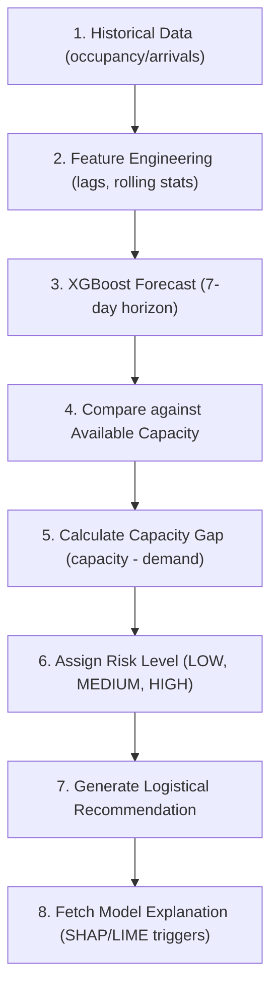

# Shortage Detection and Recommendation Engine Methodology

This document outlines the design, logical flow, and academic distinctions of the decision-support layer of the platform, structured for your B.Tech project viva presentation.

---

## 1. Core Academic Distinctions
In a medical decision-support platform, it is critical to separate the responsibilities of each module:

1. **Forecasting (What demand is expected?):** The machine learning layer (XGBoost) that projects demand counts ($\hat{y}$) for the next 7 days based on features (lags, rolling averages).
2. **Shortage Detection (Will expected demand exceed capacity?):** The logical comparisons layer that evaluates predicted demand against available resource limits to assign operational risk bounds.
3. **Recommendation (What operational actions should be considered?):** The administrative rules layer that maps risk levels to specific logistical workflows (e.g. bed reallocation, staffing calls).
4. **Explainability (Why did the model forecast this?):** The XAI layer (SHAP/LIME) that reveals which features influenced the forecasting model's output, giving managers transparency on model inputs.

---

## 2. Logical Flow of the System (For Viva Presentation)
Explain this sequence to the examiners to show a clean end-to-end integration:

---

## 3. Configurable Operational Logic

### A. ICU Beds Capacity Logic
- **Available Capacity ($C$):** Simulation limit (default = 2.0 beds) configured in `thresholds.py`.
- **Occupancy Rate ($R_t$):**
  $$R_t = \frac{\hat{y}_t}{C}$$
- **Capacity Gap ($G_t$):**
  $$G_t = C - \hat{y}_t$$
- **Risk Classification:**
  - **HIGH:** If $\hat{y}_t > C$
  - **MEDIUM:** If $\hat{y}_t \ge C \times 0.90$ (medium threshold)
  - **LOW:** If $\hat{y}_t < C \times 0.90$

### B. ED Arrivals Demand Pressure
Emergency Department arrivals are a demand metric (rate of influx) and not a direct measure of physical bed capacity.
- **Baseline ($B$):** Configured historical baseline (default = 2.0 arrivals).
- **Risk Classification:**
  - **HIGH (Elevated Demand):** If $\hat{y}_t > B \times 1.20$ (20% increase)
  - **MEDIUM (Baseline Match):** If $\hat{y}_t \ge B$
  - **LOW:** If $\hat{y}_t < B$

---

## 4. Operational Guardrails (Non-Clinical Boundaries)
To ensure safety and ethical compliance, the platform enforces strict guardrails:
- **Logistical Actions Only:** Recommendations focus solely on bed allocation, staffing prep, and baseline monitoring.
- **No Clinical Content:** The system does **not** provide patient diagnoses, clinical decisions, drug prescriptions, or medical treatment suggestions.

---

## 5. Capacity Data Limitations & Simulation
The raw MIMIC clinical databases contain anonymized patient stay logs but lack physical ward capacity variables (total bed bounds). Therefore:
- The capacities defined in `thresholds.py` are simulated administrative values to demonstrate decision-support.
- In production, these parameters will connect directly to real-time hospital administrative feeds.
- If capacity parameters are missing, the engine returns "Capacity data unavailable" instead of fabricating data.
