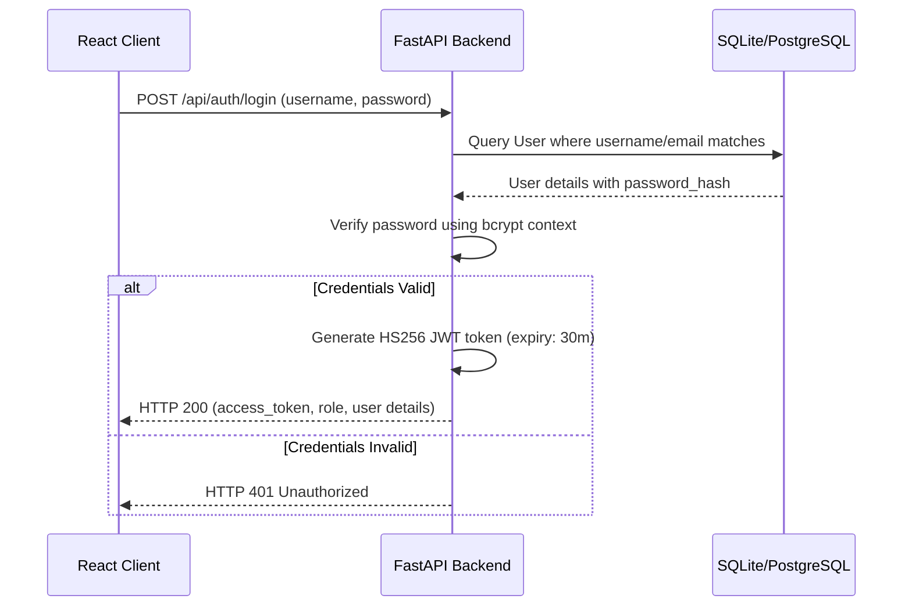

# Stage 16 Authentication & Data Management Documentation

This document explains the security, session flow, role permissions, and dataset transaction engine designed for the **Hospital Resource Intelligence Platform** during Stage 16.

---

## 1. Authentication Architecture

The system uses standard token-based authentication using **JSON Web Tokens (JWT)**:
* **Password Hashing:** Passwords are hashed using `passlib` with the `bcrypt` algorithm. Plaintext passwords are never stored or logged.
* **Token Issuer:** FastAPI handles credentials verification, generating HS256 JWT payloads signed with a secret server token (`JWT_SECRET`).
* **Session Persistence:** Tokens are returned upon successful login, stored on the client, and sent as `Authorization: Bearer <token>` HTTP headers on subsequent requests.

---

## 2. JWT Authentication Flow

---

## 3. User Roles & Permission Matrix

The system enforces three primary access roles:
* **ADMIN:** Full capability (manages user registration, imports datasets, manually adds entries, and accesses read-only sections).
* **PLANNER:** Operational capacity management (imports datasets, manually records observations, and views dashboard sections). No user management access.
* **VIEWER:** Read-only access. Forbidden from dataset uploads, manual entries, or registration.

### Permission Mapping Table

| Tab / Capability | API Request | ADMIN | PLANNER | VIEWER |
| :--- | :---: | :---: | :---: | :---: |
| View Dashboard Charts | `GET` | **Yes** | **Yes** | **Yes** |
| View Shortage Alerts | `GET` | **Yes** | **Yes** | **Yes** |
| Register Other Users | `POST /api/auth/register` | **Yes** | No | No |
| Validate Uploaded Files | `POST /api/data/upload` | **Yes** | **Yes** | No |
| Import Dataset Previews | `POST /api/data/import` | **Yes** | **Yes** | No |
| Save Manual Entry Rows | `POST /api/data/manual` | **Yes** | **Yes** | No |

---

## 4. Database Schema Changes

Two tables were added to support authentication and metadata:

### A. Table `users`
* `id` (INTEGER, Primary Key)
* `username` (VARCHAR(50), Unique, Indexed)
* `email` (VARCHAR(100), Unique, Indexed)
* `password_hash` (VARCHAR(255))
* `role` (VARCHAR(20), Constraint: `'ADMIN'`, `'PLANNER'`, `'VIEWER'`)
* `is_active` (BOOLEAN, default: `True`)
* `created_at`, `updated_at` (TIMESTAMP WITH TIME ZONE)

### B. Table `data_entries`
* `id` (INTEGER, Primary Key)
* `date` (DATE, Indexed)
* `resource` (VARCHAR(50), Constraint list: the seven resources)
* `value` (NUMERIC(12,4))
* `source_type` (VARCHAR(50), Constraint: `'ORIGINAL_DATASET'`, `'UPLOADED_DATASET'`, `'MANUAL_ENTRY'`, `'SIMULATED'`)
* `created_by` (INTEGER, Foreign Key referencing `users(id)`)
* `created_at` (TIMESTAMP WITH TIME ZONE)

---

## 5. Dataset Upload & Validation Flow

Files uploaded to `POST /api/data/upload` (accepts CSV and Excel `.xlsx` formats) undergo validation:
1. **File Constraint Check:** Extensions must end with `.csv` or `.xlsx`, and size must not exceed 5MB.
2. **Column Consistency:** Detections verify that headers contain `date`, `resource`, and `value`.
3. **Observation Checks:**
   - **Date Format:** Values must resolve to standard date strings.
   - **Target Match:** Resources must belong to the approved 7 target categories.
   - **Numeric Format:** Quantities must be valid non-negative floats.
4. **Duplicate Warnings:** Rows containing matching date and resource targets raise validation warning summaries without blocking the import.

Importing valid data inserts records under the `UPLOADED_DATASET` provenance source.

---

## 6. Manual Entry Workflow

Through the **Data Management** panel, users enter observation details:
* Date is parsed, and non-empty inputs are saved as individual rows in the `data_entries` table.
* Resource values are verified (must be positive numbers; Oxygen remains continuous, and discrete items round up to integers during card visualizations).
* Observation source types are marked as `MANUAL_ENTRY` with the creator's user ID.

---

## 7. Data Provenance & Academic Transparency

To prevent misleading claims, manual or uploaded transactions are stored in a dedicated `data_entries` table.
* Handled datasets are badged as `Uploaded` or `Manual`, ensuring that they are never represented as original observations.
* **Important Rule:** Importing data **does not trigger model retraining** or modify static XGBoost/LSTM forecast files. The dashboard clearly states: *"Data imported successfully. Model retraining is not automatically performed."*

---

## 8. API Specifications

* `POST /api/auth/register` (Admin registers user)
* `POST /api/auth/login` (Returns access token)
* `GET /api/auth/me` (Returns current user session details)
* `POST /api/auth/logout` (Invalidates session state)
* `POST /api/data/upload` (Parses and validates CSV/Excel files)
* `POST /api/data/import` (Saves uploaded rows to `data_entries` table)
* `POST /api/data/manual` (Saves manual entries)
* `GET /api/data/entries` (Lists history of all manual/uploaded logs)

---

## 9. Security Controls
* Secure bcrypt password hashing.
* OAuth2 password token bearer validation.
* Whitelisted CORS ports with security disclaimer response headers.
* Input validation on file size, structure, date format, and values.

---

## 10. Verification Tests
Two test suites were added to cover the new features:
* `tests/test_auth.py` (registers, logins, verifies invalid tokens, and roles restrictions).
* `tests/test_data_management.py` (tests CSV structure checks, spreadsheet validation, imports, and manual entries).

---

## 11. Known Limitations
* Model retraining is not automatically performed on new data; it is flagged to the user.
* Ingested CSV files must have dates formatted consistently to avoid validation warnings.
